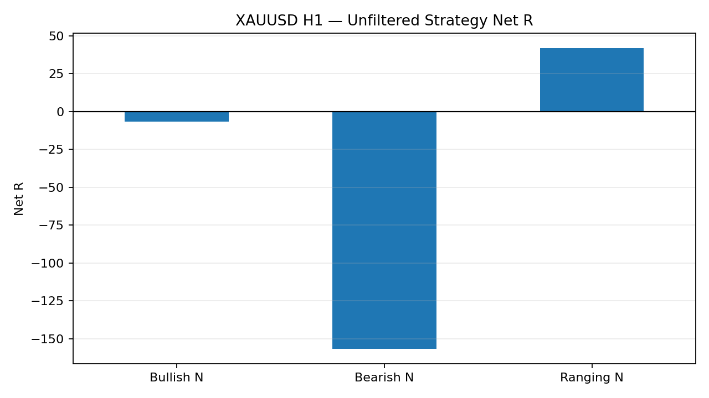
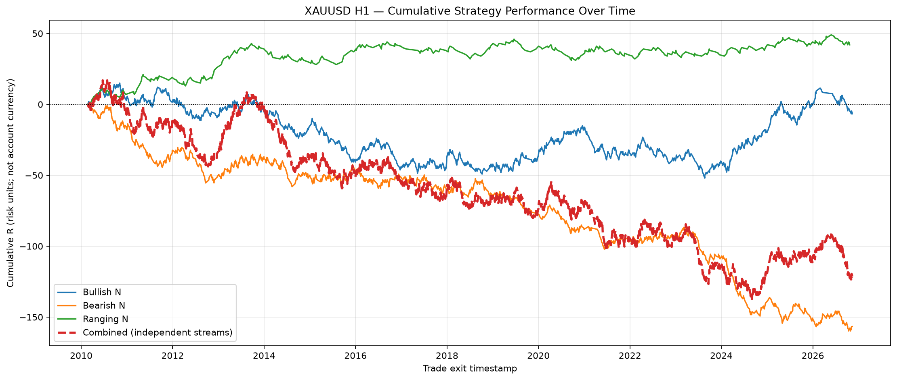
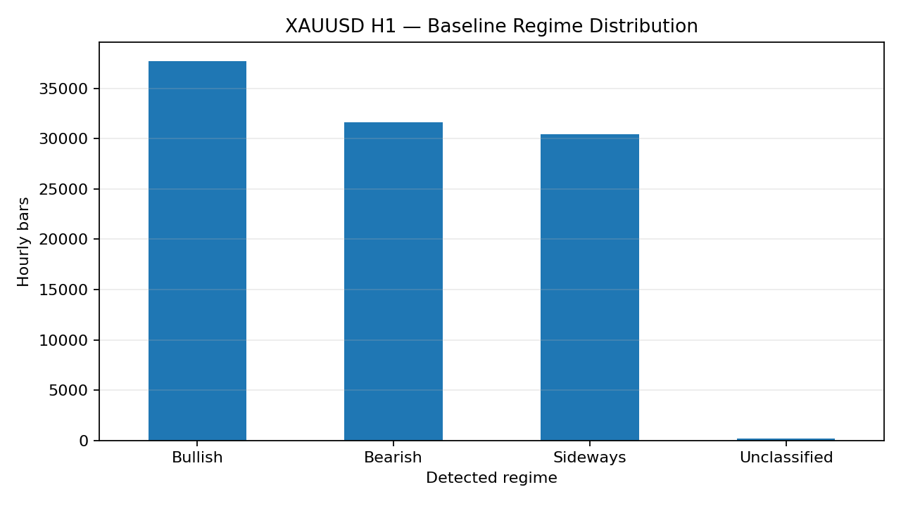
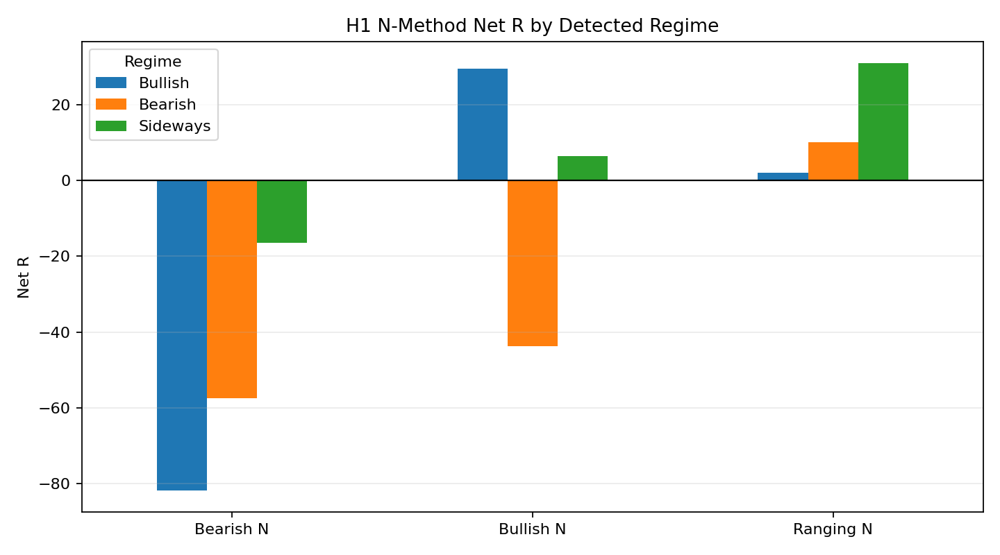
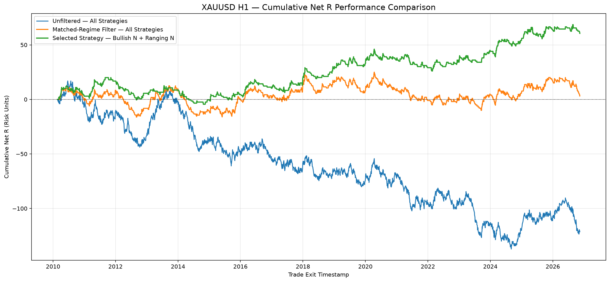

# XAUUSD H1 Quantitative Research: N-Method and Baseline Regime Detection

## Research status

**The current results are historical exploratory backtest results, not a validated trading system.** They are not evidence of live profitability and should not be used as a standalone basis for risking capital.

### Central research question

> **Does regime classification improve the N-Method's risk-adjusted performance on data that was never used to design the rules?**

This H1 study repeats the earlier D1 methodology using the supplied hourly XAUUSD OHLCV dataset.

## Executive summary

- Source data: **100,000 hourly bars**, from **2010-02-22 18:00:00** through **2026-11-12 06:00:00**.
- Three N-Method variants were tested: Bullish N, Bearish N, and Ranging N.
- Baseline regime detection uses EMA(50), EMA(200), and ADX(14).
- The unfiltered strategies generated **2,946 valid trades** (ambiguous OCO triggers excluded).
- Combined unfiltered performance was **-121.39R**, with a **0.940 profit factor**.
- The pre-defined matched-regime subset retained **977 trades** and returned **+3.13R** with a **1.005 profit factor**. This is close to breakeven before trading costs and is not conclusive evidence of an edge.

## 1. Dataset and data quality

| Item | Value |
|---|---|
| Instrument | XAUUSD |
| Timeframe | H1 |
| Source file | `data/XAUUSD_H1.csv` |
| Rows after parsing | 100,000 |
| First timestamp | 2010-02-22 18:00:00 |
| Last timestamp | 2026-11-12 06:00:00 |
| Number of columns | 6 (Date, Open, High, Low, Close, Volume) |
| Duplicate timestamps removed | 0 |
| Invalid OHLC bars | 0 |
| Timestamp timezone | Not specified in the supplied CSV |

The source CSV is headerless. Volume is retained but not used by the strategy or regime model. Timestamp timezone and vendor-specific volume semantics have not been independently established.

## 2. Methodology

### 2.1 N-Method strategy rules

| Strategy | Pattern | Entry | Stop-loss |
|---|---|---|---|
| Bullish N | P1 swing low → P2 swing high → P3 higher swing low | Buy stop above P2 | Below P3 |
| Bearish N | P1 swing high → P2 swing low → P3 lower swing high | Sell stop below P2 | Above P3 |
| Ranging N | Two similar highs and two similar lows | OCO breakout orders beyond both boundaries | Beyond the opposite range boundary |

Take-profit is fixed at **2R**. A pivot requires 3 bars on its left and 3 bars on its right and is only available after the right-side confirmation bars have closed. Entry orders become active on the next bar and expire after 20 H1 bars. Each strategy is backtested independently with one position at a time.

This is an operational interpretation of the patterns, not a verified reproduction of a proprietary Traders Family rulebook.

### 2.2 Baseline regime classifier

| Regime | Rule |
|---|---|
| Bullish | ADX(14) ≥ 20 and EMA(50) > EMA(200) |
| Bearish | ADX(14) ≥ 20 and EMA(50) < EMA(200) |
| Sideways | ADX(14) < 20 |
| Unclassified | Required indicator values unavailable |

Regime is assigned using indicator values available at the setup's `signal_date`. The pending entry order starts on the following H1 bar. EMA alignment indicates directional bias; ADX estimates trend strength but does not determine direction.

### 2.3 Parameter consistency across timeframes

The numeric settings were kept identical to the D1 baseline, rather than rescaled:

| Parameter | Setting | H1 interpretation |
|---|---:|---|
| Swing pivot left / right | 3 / 3 | 3 H1 bars on each side |
| ATR | 14 | 14 H1 bars |
| EMA | 50 / 200 | 50 / 200 H1 bars |
| ADX | 14 | 14 H1 bars |
| ADX threshold | 20 | Same numeric threshold |
| Entry buffer | 0.05 ATR | Same numeric multiple |
| Stop buffer | 0.05 ATR | Same numeric multiple |
| Range tolerance | 0.50 ATR | Same numeric multiple |
| Pending-order expiry | 20 bars | 20 H1 bars (roughly 20 market hours, not 20 days) |
| Reward-to-risk | 2.0R | Same |

**Important:** identical bar counts do not represent identical calendar-time horizons across H1 and D1. This is a direct replication of the rule settings, not a time-normalized timeframe comparison.

## 3. Results: unfiltered N-Method backtest

| Strategy   |   Trades |   Win rate % |    Net R |   Profit factor (R) |   Avg R |   Max consecutive losses |
|:-----------|---------:|-------------:|---------:|--------------------:|--------:|-------------------------:|
| Bullish N  | 1302.000 |       33.564 |   -6.692 |               0.992 |  -0.005 |                   15.000 |
| Bearish N  | 1227.000 |       29.666 | -156.684 |               0.823 |  -0.128 |                   17.000 |
| Ranging N  |  417.000 |       36.691 |   41.985 |               1.159 |   0.101 |                    9.000 |



### Cumulative performance over time

The following equity-curve views show cumulative trade outcomes in R multiples (risk units), not cash profit or account percentage returns. The combined curves are illustrative trade-level aggregates; they are not portfolio simulations with shared capital, overlapping-position controls, or transaction costs.



**Initial reading:** Bullish N was approximately breakeven before costs, Bearish N was materially negative, and Ranging N was positive in this historical sample. The Ranging N result is promising enough to investigate, but it is not validated and may be affected by sample period, parameter choices, and costs.

## 4. Regime distribution

| Regime       |   Bars |   Share % |
|:-------------|-------:|----------:|
| Bullish      |  37711 |    37.711 |
| Bearish      |  31640 |    31.640 |
| Sideways     |  30461 |    30.461 |
| Unclassified |    188 |     0.188 |



## 5. Strategy performance by detected regime

| Strategy   | Regime       |   Trades |   Win rate % |   Net R |   Profit factor (R) |   Avg R |
|:-----------|:-------------|---------:|-------------:|--------:|--------------------:|--------:|
| Bullish N  | Bullish      |  447.000 |       35.794 |  29.536 |               1.102 |   0.066 |
| Bullish N  | Bearish      |  434.000 |       30.415 | -43.719 |               0.858 |  -0.101 |
| Bullish N  | Sideways     |  419.000 |       34.368 |   6.491 |               1.023 |   0.015 |
| Bullish N  | Unclassified |    2.000 |       50.000 |   1.000 |               2.000 |   0.500 |
| Bearish N  | Bullish      |  446.000 |       27.803 | -81.805 |               0.752 |  -0.183 |
| Bearish N  | Bearish      |  363.000 |       28.650 | -57.410 |               0.782 |  -0.158 |
| Bearish N  | Sideways     |  417.000 |       32.614 | -16.468 |               0.943 |  -0.039 |
| Bearish N  | Unclassified |    1.000 |        0.000 |  -1.000 |               0.000 |  -1.000 |
| Ranging N  | Bullish      |  142.000 |       33.803 |   1.985 |               1.021 |   0.014 |
| Ranging N  | Bearish      |  107.000 |       36.449 |  10.000 |               1.147 |   0.093 |
| Ranging N  | Sideways     |  167.000 |       39.521 |  31.000 |               1.307 |   0.186 |
| Ranging N  | Unclassified |    1.000 |        0.000 |  -1.000 |               0.000 |  -1.000 |



Selected observations:

- **Bullish N:** positive only in the Bullish regime (+29.54R across 447 trades); it lost money in the Bearish regime.
- **Bearish N:** negative in all three regimes, with the largest loss in the Bullish regime. This is the weakest variant in the current H1 experiment.
- **Ranging N:** generated its strongest conditional result in Sideways conditions (+31.00R across 167 trades; PF 1.307). It was also positive in the Bearish regime.

These are conditional historical associations, not causal evidence. The regime labels are lagging and the results do not show that regime classification itself caused the performance difference.

## 6. Context versus the earlier D1 baseline

| Strategy | Timeframe | Trades | Win rate % | Net R | Profit factor (R) |
|---|---:|---:|---:|---:|---:|
| Bullish N | D1 | 74 | 41.89 | +18.87 | 1.438 |
| Bullish N | H1 | 1,302 | 33.56 | -6.69 | 0.992 |
| Bearish N | D1 | 56 | 28.57 | -10.44 | 0.748 |
| Bearish N | H1 | 1,227 | 29.67 | -156.68 | 0.823 |
| Ranging N | D1 | 16 | 37.50 | +0.03 | 1.003 |
| Ranging N | H1 | 417 | 36.69 | +41.99 | 1.159 |
| All strategies | D1 | 146 | 36.30 | +8.46 | 1.090 |
| All strategies | H1 | 2,946 | 32.38 | -121.39 | 0.940 |

The H1 experiment generated many more signals, but its total unfiltered result is substantially weaker, mainly due to the Bearish N variant. **This is not a clean apples-to-apples timeframe comparison:** bar-based settings were held numerically constant, so a 20-bar expiry is 20 hours on H1 but 20 daily bars on D1; pivot and indicator lookbacks also represent different elapsed time. The D1 and H1 source samples also have slightly different start/end timestamps.

A separate time-normalized H1 experiment would be needed to compare comparable calendar-time horizons.

## 7. Regime filter versus original unfiltered results

The matched-regime mapping was fixed in advance for this comparison: Bullish N → Bullish; Bearish N → Bearish; Ranging N → Sideways.

| Strategy       | Selection                      |   Trades |   Win rate % |    Net R |   Profit factor (R) |   Avg R |
|:---------------|:-------------------------------|---------:|-------------:|---------:|--------------------:|--------:|
| Bullish N      | No regime filter               | 1302.000 |       33.564 |   -6.692 |               0.992 |  -0.005 |
| Bullish N      | Matched regime only (Bullish)  |  447.000 |       35.794 |   29.536 |               1.102 |   0.066 |
| Bearish N      | No regime filter               | 1227.000 |       29.666 | -156.684 |               0.823 |  -0.128 |
| Bearish N      | Matched regime only (Bearish)  |  363.000 |       28.650 |  -57.410 |               0.782 |  -0.158 |
| Ranging N      | No regime filter               |  417.000 |       36.691 |   41.985 |               1.159 |   0.101 |
| Ranging N      | Matched regime only (Sideways) |  167.000 |       39.521 |   31.000 |               1.307 |   0.186 |
| All strategies | No regime filter               | 2946.000 |       32.383 | -121.391 |               0.940 |  -0.041 |
| All strategies | Matched regime only            |  977.000 |       33.777 |    3.125 |               1.005 |   0.003 |

**Aggregate comparison:** the matched filter reduced the valid trade count from 2,946 to 977. Average R per trade moved from -0.041R to +0.003R and profit factor moved from 0.940 to 1.005. The filtered aggregate was only marginally positive before costs.

## Cumulative Performance: Unfiltered vs Regime-Filtered vs Selected Strategies

The chart compares three cumulative Net R performance curves:

1. **Unfiltered:** All valid Bullish N, Bearish N, and Ranging N trades.
2. **Matched-Regime Filter:** Bullish N in Bullish regimes, Bearish N in Bearish regimes, and Ranging N in Sideways regimes.
3. **Selected Strategies:** Bullish N in Bullish regimes and Ranging N in Sideways regimes. Bearish N trades are excluded.



### Interpretation Notes

- Returns are grouped by trade exit timestamp before calculating cumulative R.
- `OPEN_AT_END` trades are included as final mark-to-market observations, not as realized closed trades.
- These are aggregate trade-level curves, not a shared-capital portfolio simulation. They do not enforce simultaneous-position limits, capital allocation, or margin constraints.
- R represents a risk unit, not a currency amount or percentage return.
- Trading costs, including spread, commission, swap, and slippage, are excluded.
- Historical results are exploratory backtest results, not evidence of a validated trading system.

## 8. Key limitations

1. **Exploratory in-sample results:** the current analysis is historical and has not been validated on unseen data.
2. **H1 costs:** spread, commission, swap, and realistic slippage are not included. These can materially change H1 results.
3. **OHLC execution assumptions:** if stop and target are both touched in one H1 candle, stop-loss is assumed first. For a range OCO setup where both boundaries are touched in the same bar, the signal is marked ambiguous and excluded.
4. **Gap fills:** entry and exit logic accounts for open-price gaps, but not all broker execution details.
5. **Independent strategy streams:** the three variants are backtested separately. Their combined results do not enforce a shared capital pool, simultaneous position limits, or portfolio-level risk controls.
6. **Not a full risk-adjusted portfolio analysis:** Net R, average R, and profit factor are trade-level performance diagnostics. Sharpe/Sortino ratios, portfolio drawdown, margin usage, and synchronized portfolio equity have not been evaluated under shared exposure constraints.
6. **Open-at-end trades:** these are marked to the final close and are not realized closed trades.
7. **Model lag:** EMA and ADX are lagging indicators and can identify regime changes late.
8. **Parameter horizon:** keeping the same number of bars on H1 and D1 changes the calendar-time horizon substantially.
9. **Data provenance:** the input vendor and timezone were not stated in the supplied CSV; verify data licensing before public redistribution.

## 9. Recommended next steps

1. Freeze the current baseline rules and parameters.
2. Run chronological out-of-sample / walk-forward validation; do not tune on the final holdout period.
3. Add broker-specific spread, commission, swap, and slippage assumptions.
4. Test the strategy with shared portfolio exposure and overlapping-trade constraints.
5. Forward-test the locked rules on new H1 bars before considering live deployment.

The next research milestone is not to optimize the regime thresholds on this full sample. It is to establish whether the current regime classification improves performance on observations that were not used to design the rules.

## 10. Repository structure

```text
XAUUSD_H1_Quant_Research_Portfolio/
├── README.md
├── requirements.txt
├── .gitignore
├── data/
│   ├── XAUUSD_H1.csv
│   └── README.md
├── notebooks/
│   ├── 01_N_Method_Backtest_H1.ipynb
│   └── 02_Baseline_Regime_Analysis_H1.ipynb
├── outputs/
│   ├── XAUUSD_H1_N_method_summary.csv
│   ├── XAUUSD_H1_N_method_trades.csv
│   ├── XAUUSD_H1_N_method_trades_with_regime.csv
│   ├── XAUUSD_H1_regime_distribution.csv
│   ├── XAUUSD_H1_regime_performance.csv
│   └── XAUUSD_H1_regime_filter_vs_baseline.csv
└── assets/
    ├── h1_unfiltered_net_r.png
    ├── h1_regime_distribution.png
    └── h1_net_r_by_regime.png
```

## 11. Reproducibility

Recommended environment: Python 3.10+.

```bash
python -m venv .venv
source .venv/bin/activate  # macOS / Linux
python -m pip install --upgrade pip
python -m pip install -r requirements.txt
```

Open the project in VS Code or Jupyter and run notebooks in order:

1. `notebooks/01_N_Method_Backtest_H1.ipynb`
2. `notebooks/02_Baseline_Regime_Analysis_H1.ipynb`

The notebooks read the CSV from `data/` and write generated tables to `outputs/`.

## Disclaimer

This repository is for educational and quantitative research purposes only. It is not investment advice, a signal service, or a recommendation to trade. Backtested performance is hypothetical and does not guarantee future results.
